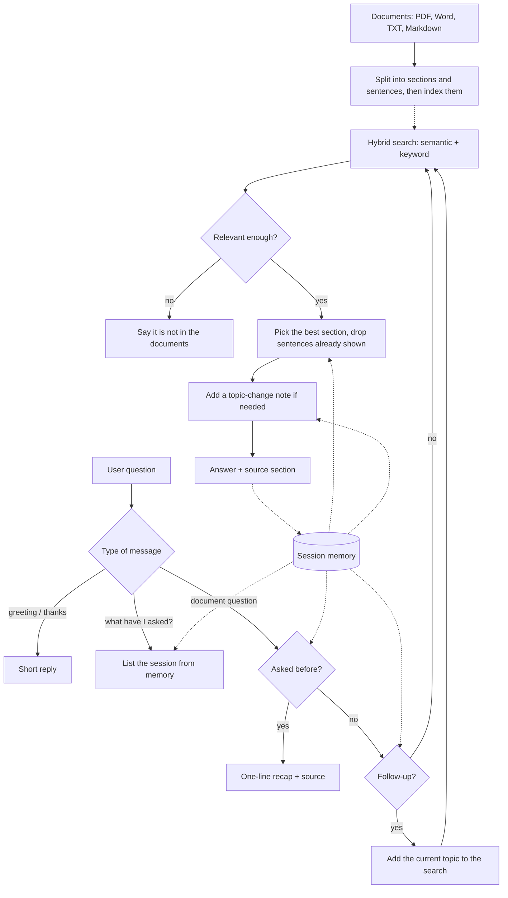

# Document-Assistant

A support assistant that answers questions **only from the documents you give it**. Upload PDF, Word, TXT or
Markdown files, then hold a multi-turn conversation: the assistant remembers what you asked, does not repeat
itself, handles topic changes, and cites the exact document section behind every answer.

Runs fully on your own machine. **No API key, no paid service, no data leaves your computer.**

---

## Problem statement

> Using your own documents as a knowledge base, build a document-aware support assistant that maintains context
> across a multi-turn conversation. The assistant should: remember what the user has already asked within the
> session, avoid repeating information it has already provided, gracefully handle topic switches, and cite the
> specific document section it is drawing from in each response. Demonstrate it across a conversation of at
> least 10 turns.

## Solution

The assistant splits the documents into sections and sentences, finds the sentences that answer each question
with a hybrid search (semantic meaning plus keywords), and keeps a **session memory** of the whole conversation.
Before every answer it checks that memory to decide *how* to reply.

| Requirement | How this project meets it |
|---|---|
| Own documents as knowledge base | Documents are uploaded in the web app (or placed in `knowledge_base/`), read at run time and split into sections and sentences. Nothing is pre-trained on them. |
| Maintains context across turns | Vague follow-ups such as "tell me more", "what if I lose my phone?" or "how long does it take?" are resolved using the current topic from memory. |
| Remembers what the user asked | Every question is stored. A repeated question is recognised ("You already asked this in turn 2") and "What have I asked so far?" lists the session. |
| Avoids repeating information | Every sentence shown is tracked; later answers skip it and say so ("Leaving out what I already told you in turn 4"). |
| Handles topic switches gracefully | A change of document or section is detected and announced ("Switching topics: from CloudNest Billing Policy to CloudNest Troubleshooting"). |
| Cites the specific section | Every answer ends with its source, e.g. `billing_policy.md › §2.3 Refund Policy`. |
| 10+ turn conversation | Demonstrated in the demo video (see [Demo](#demo)). |

It also refuses questions the documents cannot answer instead of guessing, because every sentence in an answer is
taken word for word from a cited section.

---

## How it works



**Search.** Each sentence (with its section title for context) is scored two ways and the scores are combined:

- **Semantic search** with the free `all-MiniLM-L6-v2` sentence-transformers model, which matches meaning
  ("get my money back" finds the refund section).
- **BM25 keyword search**, which never misses exact terms such as "2FA", "UPI" or an e-mail address.

Final score = `0.7 x semantic + 0.3 x keyword`. If the model is not installed, a TF-IDF search is used
automatically, so the project always runs.

**Each turn, step by step**

1. **Message type:** greetings, thanks, "what can you do?" and "what have I asked?" are handled directly.
2. **Repeat check:** if the question is almost the same as an earlier one, a one-line recap is given.
3. **Follow-up check:** follow-up phrases, or a vague question with "it" or "that", inherit the current topic.
   A question that clearly names a new topic is never treated as a follow-up.
4. **Search** all sentences with the hybrid search.
5. **Relevance check:** if nothing is relevant enough, the assistant says so instead of guessing.
6. **Section choice:** the best section is chosen (the current one is preferred for follow-ups) and sentences
   already shown are removed. If a section is fully covered, the assistant says so and moves to the next related one.
7. **Reply:** topic-change note, up to three new sentences, and the source section. The turn is saved to memory.

---

## Project structure

```
doc-support-assistant/
├── app.py                   Web app: upload documents and chat (main entry point)
├── cli.py                   Terminal chat (optional)
├── requirements.txt         Python libraries to install
├── knowledge_base/          Sample documents, loaded when nothing is uploaded
│   ├── user_guide.md          §1.1 – §1.5
│   ├── billing_policy.md      §2.1 – §2.5
│   └── troubleshooting.md     §3.1 – §3.4
├── doc_assistant/           The assistant itself
│   ├── loader.py              Reads PDF / Word / TXT / MD and splits them into sections and sentences
│   ├── retriever.py           Hybrid search: sentence-transformers + BM25 (TF-IDF fallback)
│   ├── memory.py              Session memory: questions, sentences shown, current topic
│   ├── assistant.py           Conversation logic: follow-ups, repeats, topic switches, citations
│   └── config.py              Model name and tuning thresholds
├── tests/
│   └── test_assistant.py      16 automated tests
├── .streamlit/config.toml   Streamlit settings
├── LICENSE
└── README.md
```

The sample documents describe a fictional cloud-storage product, "CloudNest", so the project can be tried
without any files of your own.

---

## Running the project locally

### 1. Requirements

- **Python 3.10 or newer.** Check with `python --version` (or `python3 --version` on macOS/Linux).
  Download it from [python.org](https://www.python.org/downloads/) if needed. On Windows, tick
  **"Add Python to PATH"** during installation.
- **About 1.5 GB of free disk space** for the libraries and the model.
- **An internet connection for the first setup only.** After that, the project works offline.

### 2. Get the code

With Git:

```bash
git clone https://github.com/<your-username>/doc-support-assistant.git
cd doc-support-assistant
```

Or click **Code > Download ZIP** on GitHub, unzip it, and open a terminal inside the unzipped folder.

### 3. Create a virtual environment

A virtual environment keeps this project's libraries separate from the rest of your system.

**Windows (Command Prompt or PowerShell)**

```bash
python -m venv venv
venv\Scripts\activate
```

**macOS / Linux**

```bash
python3 -m venv venv
source venv/bin/activate
```

When it is active, your terminal prompt starts with `(venv)`. Run the activate command again each time you
open a new terminal.

### 4. Install the libraries

**Linux only (recommended):** install the CPU version of PyTorch first. Otherwise pip downloads the GPU
version, which needs about 4 GB more and is not used by this project.

```bash
pip install torch --index-url https://download.pytorch.org/whl/cpu
```

**All systems:**

```bash
pip install -r requirements.txt
```

This takes a few minutes the first time.

### 5. Start the web app

```bash
python -m streamlit run app.py
```

Your browser opens at **http://localhost:8501**. If it does not, open that address manually.

On the first start, the language model (about 90 MB) is downloaded once; the sidebar then shows
**Retrieval: Semantic (MiniLM) + keyword**.

### 6. Use it

1. In the sidebar, **upload one or more documents** (PDF, DOCX, TXT or MD). If you upload nothing, the sample
   documents are used.
2. Open **Indexed sections** to see the sections that were found.
3. Type questions in the box at the bottom. Each answer shows a label (Answer, Follow-up, Topic switch,
   Already answered, Not in documents), the answer with key facts in bold, and its source section.
4. The **Session** panel shows the questions asked, the number of sentences already shown and the current topic.
   **Reset conversation** clears the memory.

Uploading different files starts a fresh conversation about them. To stop the app, press **Ctrl + C** in the terminal.

### 7. Optional: terminal chat and tests

Chat in the terminal about the sample documents, or about a folder of your own:

```bash
python cli.py
python cli.py --docs path/to/your/folder
```

Commands inside the terminal chat: `/history`, `/reset`, `/quit`.

Run the automated tests:

```bash
python -m unittest discover -s tests -v
```

---

## Using your own documents

Upload them in the web app, or put them in `knowledge_base/` and restart. Supported formats: **PDF, DOCX, TXT, MD**.

| The document has | Example | Cited as |
|---|---|---|
| Numbered headings (Markdown `##`, Word heading styles, or lines like `2.3 Refund Policy`) | `2.3 Refund Policy` | `policy.pdf › §2.3 Refund Policy` |
| Headings without numbers | `Refund Policy` | `policy.docx › Refund Policy` |
| No headings (PDF) | plain pages | `policy.pdf › Page 3` |
| No headings (Word or TXT) | plain paragraphs | `notes.txt › Part 2` (every 5 sentences) |

The first heading, or a short first line such as "Shipping FAQ", becomes the document's title.
Documents with clear headings give the most precise citations.

**Tuning.** Settings are in `doc_assistant/config.py`. The most useful one is `min_relevance`: raise it if the
assistant answers questions it should refuse, lower it if it refuses questions the documents do answer.

---

## Demo

**Demo video:** _add your video link here_

The video shows documents being uploaded and a live conversation of more than 10 turns. With the sample
documents, this conversation shows every feature:

| # | Question | What it demonstrates |
|---|---|---|
| 1 | How much does the Plus plan cost? | Answer with source `billing_policy.md › §2.1 Plans and Pricing` |
| 2 | What else do I get if I pay yearly? | Follow-up: stays on §2.1 and leaves out what turn 1 already said |
| 3 | Can I get a refund? | New section: "Moving on from §2.1 Plans and Pricing to §2.3 Refund Policy" |
| 4 | How long does it take to get the money back? | Follow-up phrased differently: gives only the new fact (5 to 7 working days) |
| 5 | My files are not syncing on my laptop | Topic switch to another document (Troubleshooting) |
| 6 | Tell me more | Vague follow-up resolved from memory: the rest of §3.2 |
| 7 | How do I turn on two-factor authentication? | Topic switch to the User Guide |
| 8 | What if I lose my phone? | "I already covered §1.4 in turn 7", then the answer from §3.1 Login Problems |
| 9 | How much does the Plus plan cost? (again) | Already answered: "You already asked this in turn 1", one-line recap only |
| 10 | I deleted a file by mistake, can I recover it? | Topic switch to §1.5 Deleting and Recovering Files |
| 11 | Do you sell laptops? | Not in documents: refuses to guess and lists the available topics |
| 12 | What have I asked so far? | Session history: every question with the section it used |

Example turn:

```text
User:      How long does it take to get the money back?
Assistant: [Follow-up] Continuing with §2.3 Refund Policy. (Leaving out what I already told you in turn 3.)
           Approved refunds return to the original payment method within 5 to 7 working days.
           Source: billing_policy.md › §2.3 Refund Policy
```

---

## Troubleshooting

| Problem | Solution |
|---|---|
| `python` is not recognised | Use `python3` (macOS/Linux) or `py` (Windows), or reinstall Python with "Add Python to PATH" ticked. |
| `streamlit` is not recognised | Activate the virtual environment first (step 3), or use `python -m streamlit run app.py`. |
| Very large download during install (Linux) | Cancel with Ctrl + C and install the CPU version of PyTorch first (step 4). |
| `No module named 'torchvision'` messages in the terminal | Harmless; nothing in this project uses it. `.streamlit/config.toml` already turns off the file watcher that prints them. |
| Sidebar shows "Keyword (TF-IDF) + BM25" | sentence-transformers is not installed or the model could not be downloaded. Run `pip install -r requirements.txt` with an internet connection, then restart. |
| Port 8501 is already in use | Run `python -m streamlit run app.py --server.port 8502`. |
| A PDF gives "No readable text found" | The PDF is a scanned image. Use a PDF with selectable text, or convert it with OCR first. |
| Changes to files in `knowledge_base/` are not picked up | Restart the app. Uploaded files are read immediately. |

---

## Limitations and future work

- Answers are extractive: sentences are taken word for word from the documents. This guarantees accuracy but
  reads less fluently than generated text. A next step is to pass the selected sentences to a local language
  model (for example through Ollama) and keep the same citations.
- Memory lasts for one session (one browser tab). It could be stored in a database to survive restarts.
- Thresholds were tuned on the sample documents; very different documents may need adjustment in `config.py`.
- Scanned PDFs need OCR; tables are read as plain text.

## Tech stack

Python · sentence-transformers (all-MiniLM-L6-v2) · NumPy · BM25 (own implementation) · pypdf · python-docx ·
Streamlit · unittest

## License

MIT
